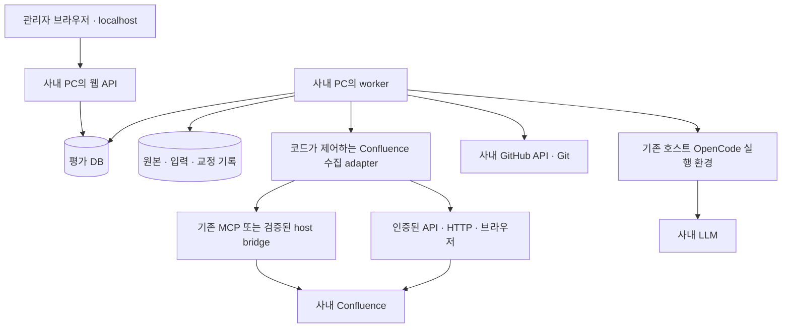

# 사내 PC·Confluence URL/MCP 연동 보완안 v0.4

- 작성일: 2026-10-23
- 반영 내용: 사내 PC에서 Confluence·GitHub·OpenCode에 접근 가능하며, OpenCode에 설치된 Confluence MCP를 터미널에서 사용했다고 사용자가 확인했다. Confluence 페이지 URL도 있으므로 MCP에 한정하지 않고 수집한다.
- 관계: [시스템 설계 v0.3](system-architecture-v0.3.md)의 데이터·평가·교정·보고 설계를 유지하면서 실행 위치와 Confluence 연결 경로를 구체화한다.
- 상태: 아래 내용은 연결 설계이며 현재 실행 코드는 [README](README.md)와 [연결 설정](config/README.md)을 따른다. REST·MCP 계약 시험과 공개 Git/OpenCode 실평가는 구분해 [검증 리포트](verification-report.md)에 기록한다. 이 작업 환경에서 실제 사내 endpoint·MCP에 직접 접속한 것은 아니다. 관리자 화면과 평가는 [기능·시스템 영향 평가 v0.5](management-evaluation-v0.5.md)를 따른다.

## 1. 확인된 사실과 추가로 검증할 항목

| 항목 | 현재 상태 |
| --- | --- |
| 사내 PC의 Confluence·GitHub 접근 | 사용자 확인 |
| 사내 PC의 OpenCode 실행 | 사용자 확인 |
| OpenCode에서 Confluence MCP 도구 사용 | 사용자 확인 |
| Confluence 대상 페이지 URL 사용 가능 | 사용자 확인. 실제 URL·루트 범위는 실행 설정에서 등록 |
| OpenCode major version·활성 설정·MCP 연결 방식 | 아직 값이 제공되지 않음. 호스트 진단에서 확인 |
| MCP의 하위 전체 목록·버전 본문·댓글·첨부 지원 | 기능 목록과 표본 호출로 확인 필요 |
| 같은 연결의 worker·headless 실행·인증 갱신 | 자동 실행 경로에서 확인 필요 |
| 코드가 원본 자료를 직접 받을 수 있는 경로 | API·MCP·인증된 HTTP·브라우저 중 기능별 사용 가능한 경로 확인 |

터미널에서 사용할 수 있다는 사실은 유효한 연결 근거다. 다만 그 사실만으로 필요한 모든 수집 기능과 다른 실행 프로세스의 인증 재사용이 검증된 것은 아니다.

## 2. 현재 환경의 우선 배치

초기에는 사내 PC에서 web·worker를 호스트 프로세스로 실행하고 기존 OpenCode 설치·허용된 인증 환경을 재사용한다. OpenCode·MCP를 새 Docker 컨테이너로 옮기는 작업은 첫 단계에 요구하지 않는다. DB·영속 원본 저장소·교정 이력은 v0.3대로 유지한다. PostgreSQL은 사내에서 허용된 호스트 설치 또는 DB용 컨테이너를 사용할 수 있다.



MCP의 인증을 처음부터 새로 만들거나 별도 Confluence 토큰 발급을 기본 전제로 삼지 않는다. 등록한 URL을 대상으로 이미 접근 가능한 MCP·API·웹 연결을 재사용한다. 한 경로에서 특정 기능을 얻을 수 없다면 다른 허용된 경로로 보완하며, MCP 자동 호출의 확인을 모든 수집의 선행 조건으로 두지 않는다.

시스템 주소·직접 사용할 Confluence·GitHub 토큰·사내 LLM 토큰은 [별도 연결 파일](config/README.md)의 `config/connections.local.json`에서 관리한다. 루트 페이지·레포 URL은 팀 설정에 둔다. 기존 MCP의 OAuth·SSO 저장소는 임의로 복제하지 않으며, 토큰을 사용하는 경로에는 연결 파일에서 필요한 값만 전달하도록 구현한다.

Docker에 web·worker를 옮기는 것은 연결·인증·CA·프록시·로컬 MCP 실행을 검증한 뒤 선택한다. 컨테이너의 localhost는 호스트의 localhost와 다르며, 호스트에 설치된 MCP 실행 파일·인증 상태가 컨테이너에 자동 제공되지 않는다. 전체 개인 설정 디렉터리를 무조건 복사·마운트하는 방식으로 해결하지 않는다.

## 3. 연결 수단과 수집 책임의 구분

원칙은 다음과 같다.

```text
수집 코드: URL·페이지 ID·수집 항목·cursor를 결정하고 원본 응답·상태를 저장
API / MCP / 인증된 HTTP·브라우저: 결정된 조회를 실행하는 연결 수단
OpenCode + LLM: 저장된 근거의 수준·난도·기여를 해석
```

MCP 자체는 모델의 자유로운 판단만으로 호출해야 하는 프로토콜이 아니다. 예를 들어 classic MCP는 도구 목록과 프로그램 호출을 정의한다. 실제 연결은 설치된 서버와 협상한 프로토콜·SDK에 맞춰 구현한다. [MCP 도구 명세](https://modelcontextprotocol.io/specification/2025-11-25/server/tools)

어떤 연결을 선택해도 LLM의 검색 선택을 거치지 않고 탐색 큐·페이지 순회·재시도를 코드로 관리한다. '루트 아래를 전부 찾아 요약하라'는 프롬프트만으로 수집을 완료시키지 않는다.

## 4. 실제 호출 경로의 선택

### A. URL을 기준으로 기능별 경로 선택

등록한 URL을 실제 페이지 ID로 확인한 뒤 본문·자식 목록·특정 버전·댓글 등 필요한 조회별로 경로를 선택한다. 본문은 MCP, 과거 버전은 API처럼 혼합할 수 있다. 사용 가능한 경로가 여러 개이면 전체 원본과 안정적인 목록·버전 조회를 제공하는 경로를 우선한다.

| 경로 | 사용 조건 |
| --- | --- |
| 직접 API | 해당 사내 버전의 기능과 실제 인증·원본 반환을 확인 |
| 기존 MCP | 해당 도구와 프로그램 호출·원본 반환을 확인 |
| 인증된 HTTP | URL에서 실제 문서 본문·식별자를 확보하고 로그인 화면·동적 누락을 구분 |
| 인증된 브라우저 | SSO·동적 렌더링이 필요하며 페이지·트리·더 보기를 프로그램에서 확인 가능 |

현재 본문의 URL만 읽었다고 하위 전체·과거 버전·댓글도 확보한 것으로 처리하지 않는다. 루트 아래 페이지의 탐색은 실제 부모·자식 관계와 페이지 순회를 따른다. 본문 링크를 모두 따라가는 일반 크롤링과 구분한다. 상세 규칙은 [v0.3의 Confluence 수집 절](system-architecture-v0.3.md#5-confluence-루트-하위-전체-수집)에 통합했다.

### B. worker의 MCP 직접 호출

기존 MCP 서버 구현·실행 설정 또는 원격 endpoint를 지원되는 방식으로 사용한다. 같은 OS 사용자·설정·프로젝트 환경을 확인하고 MCP client adapter를 연결한다.

- 로컬 stdio MCP라면 OpenCode가 소유한 stdin/stdout에 두 번째 클라이언트를 임의 연결하지 않는다. 지원되는 설정으로 별도 서버 프로세스를 실행할 수 있는지 확인한다.
- 원격 MCP라면 해당 서버와 클라이언트의 인증·세션 방식을 확인한다. OpenCode의 로그인 상태가 다른 MCP client의 로그인 상태까지 자동 보장하지 않는다.
- 자격 정보 파일을 임의 해석·복제하는 대신 기존 서버·client가 지원하는 인증 경로를 사용한다.

이 경로가 가능하면 OpenCode 플러그인을 새로 작성할 필요가 없다.

### C. 기존 호스트 환경의 작은 bridge

기존 OpenCode가 인증·MCP 연결을 소유하고 B 경로가 불가능하며 API·웹 읽기로도 필요한 자료를 확보할 수 없는 경우에만 bridge를 검토한다. 해당 버전이 지원하는 프로그램 호출·확장 경로로 원본을 얻을 수 있는지 확인한다. bridge 구현은 다른 경로로 가능한 수집을 막지 않는다.

OpenCode 2.x에는 플러그인 RPC 확장이 문서화돼 있지만, 그것이 기존 MCP 도구를 그대로 호출하는 완성된 proxy라는 뜻은 아니다. 플러그인이 원본 MCP 결과를 지원되는 방식으로 얻을 수 있는지는 별도로 확인해야 한다. 공개 경로가 없는데 임의의 내부 함수나 가상의 endpoint가 있다고 가정하지 않는다. [2.x client·Plugin RPC](https://opencode.ai/v2/docs/build/client/)

bridge를 구현한다면 수집 작업의 고정된 조회·원본 반환만 담당한다. 수집 범위·교정·DB·최종 평가·대시보드는 기존 업무 애플리케이션에 남긴다. 1.x와 2.x 플러그인은 각각의 계약으로 구현한다.

### D. 부족한 기능과 원본 처리

한 경로가 현재 페이지 읽기만 지원하고 버전 본문·댓글·페이지 순회를 지원하지 않을 수 있다. 기능별 실제 지원 여부를 기록하고 다른 경로로 보완한다. 어떤 경로에서도 확보할 수 없으면 해당 자료·판정을 미확인으로 남긴다.

MCP를 LLM이 호출한 뒤 생성한 요약만 반환하는 경로는 평가용 원본 수집의 기본 경로로 사용하지 않는다. 정확한 도구 인자·전체 반환값·잘림 여부·처리 상태를 확보할 수 없다면 완전한 수집 경로로 표시하지 않는다.

## 5. 수집 기능 점검표

아래 기능은 연결 수단과 독립된 요구다. 선택한 경로의 실제 응답을 확인한다. MCP를 사용한다면 도구 이름을 미리 지어내지 않고 실제 목록·입력 schema·응답을 기능에 매핑한다. HTTP·브라우저 경로도 파서·식별·계속 조회의 검증 상태를 남긴다.

| 업무 기능 | 필요한 내용 | 미지원 시 영향 |
| --- | --- | --- |
| 루트·페이지 읽기 | 안정된 ID, 본문, 제목, 부모·상태, 버전 정보 | 기본 문서 근거 수집 불가 또는 부분 |
| 자식·하위 목록 | 모든 하위 또는 자식 반복 탐색, 다음 페이지 표식 | 하위 전체 수집을 주장할 수 없음 |
| 버전 목록 | 버전·작성자·시각·변경 설명 | 기간 내 중간 기여를 확인하기 어려움 |
| 특정 버전 본문 | 실제 과거 본문 또는 변경을 재구성할 자료 | 버전 metadata만으로 변경 내용을 평가할 수 없음 |
| 댓글·토론 | 지원되는 댓글 유형, 작성자·시각·연결 위치 | 리뷰·분석 기여의 관찰 범위 축소 |
| 첨부·매크로 관련 자료 | 원본 또는 변환 가능한 내용과 상태 | 실험·이미지·표의 내용을 놓칠 수 있음 |
| 원본 응답 | 구조화된 값 또는 원본 HTML·DOM·첨부, 파싱·렌더링·오류·잘림 상태 | AI 요약·로그인 화면·부분 렌더링을 원본으로 오인할 위험 |
| 자동 실행·갱신 | 대화형 터미널 없이 호출 가능, 인증 만료 감지 | 장시간 수집 중 중단·보류 가능 |

MCP의 도구 목록 pagination과 특정 Confluence 조회 결과의 pagination은 서로 다르다. 도구 목록을 끝까지 가져왔다고 하위 페이지를 모두 가져온 것이 아니다. 도구 응답의 구조화 데이터도 LLM이 생성한 구조화 평가 결과와 구분한다. [MCP 도구·결과 명세](https://modelcontextprotocol.io/specification/2025-11-25/server/tools)

경로·서버 설정·도구 schema·웹 파서가 바뀌면 요청한 대상·버전·목록 범위를 검증한 뒤 반영한다. 모델에게 비슷한 이름의 도구나 페이지를 알아서 고르게 하거나 인자를 추측해 정상 수집으로 처리하지 않는다.

## 6. adapter의 제안 계약

아래는 구현할 업무 adapter의 논리적 기능이며 기존 MCP의 실제 도구 이름이나 OpenCode의 기존 endpoint를 뜻하지 않는다.

```text
ConfluenceAdapter.resolveTarget(inputUrl)
ConfluenceAdapter.capabilities(target)
ConfluenceAdapter.getPage(pageId, revision?)
ConfluenceAdapter.listChildren(pageId, continuation?)
ConfluenceAdapter.listVersions(pageId, continuation?)
ConfluenceAdapter.getVersionBody(pageId, revision)
ConfluenceAdapter.listComments(pageId, continuation?)
ConfluenceAdapter.getAttachment(attachmentId, revision?)

반환: 원본 참조 + 파싱 데이터 + continuation + 완료/부분/오류/잘림/미지원 상태
기록: source·page·version·capture ID + 실제 경로·인자 + 파서/schema 버전
      + 원래/최종 URL + 수집 시각 + 원본 해시
```

수집 worker는 이 계약을 기준으로 큐를 만든다. 재귀 탐색, 중복 루트·페이지 제거, 기간 내 버전·공동 작성 연결, 요청 재시도는 코드가 수행한다. 동일 cursor가 반복되거나 응답이 잘렸으면 완료로 처리하지 않는다. 다른 경로로 같은 페이지·버전을 읽어도 중복 기여로 계산하지 않는다.

원본·장부·근거 ID를 저장한 후 고정된 입력 묶음을 만든다. 이후 OpenCode가 자료·사례·개인 종합을 평가하고, 교정은 원본을 덮어쓰지 않는 v0.3 방식으로 적용한다.

## 7. 기존 OpenCode 설정을 재사용할 때의 경계

터미널에서 확인한 OS 사용자, 활성 프로젝트·작업 디렉터리, 설정 출처, 환경변수·네트워크·CA·프록시를 확인한다. 다른 디렉터리나 서비스 계정으로 실행하면 다른 MCP 설정이 적용될 수 있다. OpenCode는 로컬·원격 MCP와 프로젝트별 설정을 지원하므로 실제 유효 설정으로 검증한다. [1.x MCP](https://opencode.ai/docs/mcp-servers/), [2.x MCP](https://opencode.ai/v2/docs/mcp-servers/)

기존 동작 설정을 덮어쓰지 않는다. 그 연결을 재사용하는 호스트 실행 프로필과 평가 전용 컨텍스트를 분리한다. 평가 대상 레포의 AGENTS·설정을 실행 지침으로 로드하지 않는 기존 원칙도 유지한다.

수집용 MCP 연결과 평가 세션에 노출할 도구를 구분한다. 평가 모델이 새 자료가 필요하면 자료 ID·이유를 요청하고, 코드가 수집·장부 반영·새 입력 버전 생성을 수행한다. 이미 고정된 평가 입력에 즉석 조회 결과를 조용히 섞지 않는다.

브라우저에는 MCP·LLM 토큰을 노출하지 않는다. 원격 MCP의 OAuth 등 인증이 프로젝트 설정 외부에 저장될 수 있으므로 설정 파일 하나만 옮기면 연결이 복원된다고 가정하지 않는다. [2.x MCP 인증](https://opencode.ai/v2/docs/mcp-servers/#oauth)

호스트 실행 프로필에는 토큰을 중복 저장하지 않고 팀 설정의 연결 파일 참조를 상속한다. 평가 전용 OpenCode의 provider·모델 목록·기본 모델과 필요한 환경변수는 연결 파일에서 생성한다. 관리자는 평가 실행 화면에서 사용할 모델을 선택하며 실행마다 확정한 모델을 SDK/CLI에 명시한다. 기존 호스트의 개인 설정을 덮어쓰거나 연결 파일 전체를 모델에 제공하지 않는다.

## 8. 구현 시작 시 진단·수용 조건

1. 루트 URL·팀원별 레포를 등록하고 기존 호스트 실행 환경과 연결을 확인한다. 기존 터미널 사용 여부를 다시 의심하는 절차가 아니라 자동 실행 환경을 고정하는 절차다.
2. 실제 URL·API·MCP 응답에서 기능표를 만든다. MCP 도구나 별도 bridge의 확보를 모든 수집의 선행 조건으로 두지 않는다.
3. 조회 항목별로 사용 가능한 경로를 선택하고 자동 호출·원본 반환·인증 만료 상태를 시험한다. 선택한 경로의 버전·설정·파서를 기록한다.
4. 알려진 루트에서 여러 깊이·여러 페이지의 목록, 중간 버전 편집, 댓글·첨부 표본을 원본과 대조한다.
5. 코드가 원본을 보존하고 모든 발견 ID의 수집·실패·미지원 상태를 남기는지 확인한다.
6. 고정한 자료로 AI 평가와 대시보드를 만들고, 귀속 교정 시 관련 팀원 모두의 새 보고 버전이 생성되는지 검증한다.

첫 결과는 '각 연결 경로로 실제 확보한 범위'와 '아직 확인·지원되지 않는 범위'를 구분해 보여준다. 모든 기능을 추정해 프롬프트에 맡기지 않는다. PC가 절전·종료되면 장시간 작업이 멈출 수 있으므로 작업은 재개 가능하게 저장하고, 상시 운영이 필요해질 때 검증된 호스트 실행 환경을 상시 PC·서버로 옮긴다.

실행 프로필은 [host-connection-profile.example.json](design/host-connection-profile.example.json)에 둔다. 경로별 실제 디렉터리·인증 프로필·도구 매핑은 사용할 때 확인한다. MCP를 선택하지 않으면 MCP 이름·도구 매핑은 선행 입력이 아니다. 토큰 원문이나 개인 설정 전체를 요구하지 않는다.
