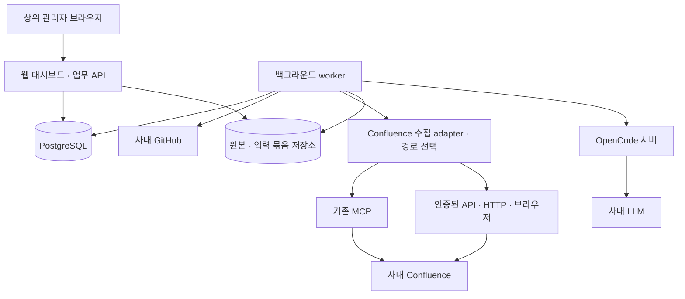

# 사내 팀원 기여 평가 시스템 구성 설계 v0.3

- 작성일: 2026-10-23
- 대상: 상위 관리자용 사내 대시보드, GitHub·Confluence 근거 수집, OpenCode를 통한 사내 LLM 평가, 사실·판정 교정과 재평가
- 평가 기준: [평가안 v0.2](contribution-evaluation-v0.2.md)와 [합리성 검토](contribution-evaluation-v0.2-review.md)의 한계를 적용한다. 현재 구현은 [기능·시스템 영향 평가 v0.5](management-evaluation-v0.5.md)의 기능별 종합·관리자 화면을 우선한다.
- 문서 성격: 구현 기준이 된 설계안이다. 현재 실행 코드·설치 방법은 [README](README.md), 상세 구현·수용 조건은 [구현 플랜](implementation-plan.md), 실제 검증 상태와 미완료 항목은 [검증 기록](verification-report.md)을 따른다. 이 설계 문서 자체가 모든 연동의 검증 증거는 아니다.

> 사내 PC·기존 Confluence MCP·페이지 URL 환경은 [호스트 연동 보완안 v0.4](host-mcp-integration-v0.4.md)에 반영했다. 현재는 기존 사내 연결을 재사용하는 호스트 실행을 우선한다. Confluence는 등록한 루트 URL을 기준으로 MCP·인증된 API·HTTP·브라우저 중 필요한 자료를 온전히 읽을 수 있는 경로를 선택한다. MCP 전용 플러그인 구현을 수집 시작의 선행 조건으로 두지 않는다.

## 1. 구성 결정

사내 웹 애플리케이션 + 백그라운드 worker + PostgreSQL + OpenCode 실행 계층으로 구성한다. 독립 서버 배포에서는 Docker Compose를 사용할 수 있다. 기존 MCP 인증이 동작하는 사내 PC를 사용하는 현재 우선 배치는 v0.4의 호스트 실행 구성을 따른다.

| 질문 | 결정 | 이유 |
| --- | --- | --- |
| 프롬프트만으로 가능한가 | 실험은 가능하지만 이 시스템에는 코드가 필요 | 전수 목록 수집, 재시도, 상태 장부, 원본 보존, 교정·버전·권한·대시보드를 보장해야 함 |
| 프롬프트의 역할 | 평가 기준과 자료 해석·종합 의견을 정의 | 수집 범위·완전성·집계의 실행 책임은 코드에 둠 |
| OpenCode SDK인가 CLI인가 | SDK를 기본 경로, CLI를 호환 경로로 추상화 | 서버의 작업·오류·세션을 프로그램에서 관리하기 쉬움 |
| OpenCode 플러그인인가 | 기본 시스템에는 필수 아님 | 수집·DB·교정·대시보드는 독립 애플리케이션의 책임 |
| 서버형이어야 하는가 | 지속적인 대시보드·장시간 수집을 위해 서버 프로세스와 영속 저장소가 적합 | 관리자 브라우저와 수집·평가 작업의 수명 분리 |
| Docker가 필수인가 | 필수 아님. 현재 사내 PC는 호스트 실행 우선, 독립 서버 배포 시 Compose 선택 | 기존 사내 인증을 활용하고 배포 환경은 나중에 분리 가능 |
| 사내 LLM도 직접 띄우는가 | 기존 사내 LLM endpoint를 사용 | 평가 서버에 모델 가중치나 GPU를 별도로 배치할 필요 없음 |
| Confluence는 MCP가 필수인가 | 아님. URL로 대상을 식별하고 기능별 수집 경로를 선택 | 기존 MCP와 직접 API·인증된 웹 읽기를 함께 사용할 수 있음 |

OpenCode는 서버·프로그램 연동 기능을 제공한다. 이 기능을 애플리케이션의 평가 실행 계층으로 사용하되, 1.x와 2.x의 API·클라이언트를 구분한다. [1.x Server](https://opencode.ai/docs/server/), [1.x SDK](https://opencode.ai/docs/sdk/), [2.x 네트워크 클라이언트](https://opencode.ai/v2/docs/build/client/)

## 2. 전체 구조



수집과 정규화는 worker의 코드가 수행한다. OpenCode에는 원본을 바탕으로 코드가 만든 입력 묶음을 전달한다. AI는 웹 대시보드의 DB나 사내 시스템을 임의 수정하지 않고 구조화된 평가·추가 자료 요청을 반환한다.

브라우저는 업무 API만 호출한다. OpenCode 서버와 DB는 내부 통신으로 연결한다. OpenCode의 세션 저장소와 별개로, 업무 시스템이 원본·평가 입력·AI 응답·교정·최종 보고 버전을 보존한다.

## 3. 첫 운영의 서비스와 기술 선택

| 서비스 | 제안 구성 | 책임 |
| --- | --- | --- |
| web | TypeScript + React 기반 대시보드와 Node.js 업무 API. 한 이미지로 배포 가능 | 설정, 실행 요청, 결과 조회, 교정 입력, 관리자 확정 |
| worker | 같은 TypeScript 코드베이스의 별도 실행 프로세스 | 수집·정규화·완전성 검사·AI 호출·검증·재계산 |
| postgres | 정책·업무 관계·작업 큐·평가·교정·보고 버전 | 영속 상태와 트랜잭션 |
| opencode | 사내에서 승인된 버전의 headless server | 사내 provider/model 호출, 세션 실행 |
| evidence volume | 영속 파일 볼륨. 확대 시 사내 객체 저장소로 교체 가능 | 원본 본문·diff·첨부·AI 입력·응답의 해시 기반 저장 |

첫 운영에서는 Redis·별도 검색 엔진·벡터 DB·Kubernetes를 필수로 두지 않는다. 작업 큐는 PostgreSQL의 작업 테이블·lease·재시도 상태로 시작한다. 근거 조회는 ID·사례 관계·필터·일반 검색을 사용한다. 벡터 검색은 나중에 탐색 보조로 추가할 수 있지만 평가 모집단을 결정하지 않는다.

처음에는 worker 하나로 순차 수집·제한된 동시 평가를 수행한다. 자료량·요청 한도·모델 처리량을 측정한 뒤 수집과 평가 worker를 분리한다. 한 번에 몇 명을 처리할 수 있는지, 저장 용량·처리 시간은 자료량을 모르므로 현재 수치로 보장하지 않는다.

## 4. 초기 설정과 팀원–레포 관계

설정 화면은 루트 페이지, 팀원, 팀원별 레포 URL을 입력하는 것으로 수집 범위를 만들 수 있어야 한다. 시스템 주소·토큰은 별도 로컬 연결 파일에서 읽으며, 화면에서는 연결 참조·상태를 확인한다. 개인 귀속을 위한 계정 매핑은 팀 설정에 둔다.

| 설정 | 입력·확인 내용 |
| --- | --- |
| Confluence 연결 | 연결 파일의 기본 URL·인증과 실제 연결 가능한 MCP·API·웹 읽기 프로필. 경로 선택 기본값은 auto |
| Confluence 루트 | 루트 페이지 URL 여러 개를 입력. ID는 코드가 확인·정규화하며 루트 자체와 하위 전체를 기본 포함 |
| GitHub 연결 | 연결 파일의 Enterprise Server/Cloud 등 배포 형태·기본 URL·인증 참조 |
| OpenCode·사내 모델 연결 | 연결 파일의 OpenCode 서버 URL·서버 인증, 사내 LLM URL·토큰·provider, 선택 가능 모델 목록·기본 모델 |
| 팀원 | 내부 person ID, 표시 이름, GitHub login, Confluence 계정 ID, 필요한 commit email 별칭 |
| 팀원별 레포 | 하나 이상의 레포 URL, 담당 기간·기대 역할 |
| 평가 실행 | 관찰 기간·시점, 기준 버전, 연결 설정의 허용 목록에서 선택한 모델. 기본 모델을 미리 선택해 표시 |
| 레포 맥락 | 목표·요구사항 문서 위치. README·등록 문서에서 후보를 추출하고 관리자가 보완 가능 |

레포는 URL 문자열마다 별도 복제하지 않는다. 호스트·실제 레포 ID를 확인해 정규화하고, 관계를 다대다로 저장한다.

```text
팀원 A ─┬─ platform 레포
팀원 B ─┘
팀원 B ─── console 레포

수집 대상: platform 1개 + console 1개
담당 관계: A-platform, B-platform, B-console
```

담당 관계는 수집 범위와 기대 역할을 정하는 자료다. 실제 기여를 특정 사람에게 자동 귀속시키거나 다른 사람의 기여를 제외하는 필터가 아니다. 등록한 레포의 관련 작성자·리뷰어·공동 작업자를 함께 수집하고, 평가 대상 팀원에 속하지 않는 사람의 기여도 맥락으로 보존한다.

URL·login은 연결 확인 후 변하지 않는 원본 시스템 ID와 연결한다. 이름 유사도로 계정을 합치지 않는다. 퇴사·이동·담당 변경에 대비해 담당 관계에 시작·종료 시점을 둔다. 설정 변경은 새 버전으로 남긴다.

레포 목표·요구사항이나 역할 기대가 아직 확인되지 않아도 수집은 진행할 수 있다. 해당 정보가 필요한 난이도·기대 충족 판정은 미확인으로 두고, 기본값을 확정 사실처럼 사용하지 않는다.

팀 설정 예시는 [team-config.example.json](design/team-config.example.json)에 둔다. 이 파일의 구조는 제안하는 업무 애플리케이션의 설정이며 OpenCode 자체 설정이 아니다. `connection_ref`는 별도 연결 파일의 `systems` 아래 키를 참조한다.

### 4.1 시스템 연결 파일과 팀 설정의 분리

각 시스템 URL과 Confluence·GitHub·OpenCode 관련 토큰은 `config/connections.local.json` 한 곳에 저장한다. [연결 파일 템플릿](config/connections.example.json)과 [관리·로더 계약](config/README.md)을 별도로 둔다. 현재 로더는 [config.ts](src/config.ts), 모델 실행기는 [opencode.ts](src/evaluation/opencode.ts)에 구현했으며 예시 URL·모델 ID·빈 토큰은 실제 연결 정보로 바꿔야 한다.

| 설정 위치 | 내용 |
| --- | --- |
| `config/connections.local.json` | 실제 Confluence·GitHub 주소와 인증, OpenCode 서버 주소·인증, 사내 LLM 주소·토큰·모델 |
| `design/team-config.example.json` | 루트 페이지·레포 URL, 팀원·계정·담당 관계, 평가 기간·기준, 연결 파일 참조 |
| `design/host-connection-profile.example.json` | 호스트 실행 환경과 수집 경로·MCP 도구 매핑. 연결 값은 팀 설정을 통해 참조 |
| `runtime/opencode/` | 연결 파일에서 생성할 버전별 OpenCode 설정. 토큰 대신 프로세스 환경변수 참조 사용 |

시스템 기본 URL과 수집 대상 URL을 구분한다. 예를 들어 Confluence 기본 주소는 연결 파일에, 루트 페이지 URL은 팀 설정에 둔다. 레포 URL도 팀원별 평가 범위이므로 팀 설정에 유지한다. 연결 파일·생성 파일은 Git에서 제외하고 공유 예시에는 가상 주소와 빈 토큰만 둔다.

애플리케이션 시작 시 기본 파일을 읽거나 `CONTRIB_CONNECTIONS_FILE`로 다른 경로를 지정한다. 상대 경로는 애플리케이션 루트에서 해석한다. 선택한 수집 경로에 필요한 필드와 참조를 검증하고 오류에는 키·사유만 표시한다. 기존 MCP가 자체 OAuth·SSO로 동작하면 그 저장소를 복제하거나 불필요한 Confluence 토큰을 요구하지 않는다.

수집기에는 해당 시스템의 인증만, OpenCode 실행기에는 사내 모델 인증과 필요한 서버 인증만 전달한다. 실행기는 연결 파일로부터 provider·모델 목록·기본 모델 설정을 생성하고 URL·LLM 토큰을 전용 프로세스 환경으로 주입한다. 실제 평가 요청에는 실행에서 선택한 모델을 명시한다. 사람이 같은 토큰을 OpenCode 설정에도 반복 입력하지 않는다. 이미 실행 중인 서버의 인증·설정을 바꾸는 것은 그 버전이 지원하는 경로로 처리하며, worker의 환경변수 변경만으로 적용된다고 가정하지 않는다.

실제 연결 파일은 실행 계정만 읽게 한다. 파일 전체·토큰·암호·환경 전체는 로그, 평가 DB, 수집 장부, 프롬프트, 설정 export, 대시보드 응답에 포함하지 않는다. 브라우저에는 허용한 URL·연결 상태·인증 설정 여부만 반환한다. 평가 이력에는 비밀 값을 제외한 허용 필드와 별도 설정 revision을 저장하며 토큰이나 토큰 해시는 저장하지 않는다.

실행은 시작 시 확인한 설정에 고정한다. 토큰 갱신은 명시적 재연결·재시작으로 반영하고 중단된 작업을 재개한다. 소스 설치 환경이나 모델이 바뀌면 새 수집·평가 실행의 입력과 버전에 반영하며 이전 근거·보고를 덮어쓰지 않는다.

## 5. Confluence 루트 하위 전체 수집

### 5.1 URL 입력과 페이지 식별

관리자는 루트 페이지 URL을 입력한다. URL에 안정된 page ID가 있으면 파싱하고 원본 조회로 확인한다. 제목 기반 URL·짧은 링크는 지원되는 조회·redirect·페이지 메타데이터를 통해 실제 페이지 ID로 확인한다. 표시 이름·제목이 같은 페이지를 검색해 임의로 선택하지 않는다. 원래 URL·최종 URL·소스 설치 환경·확인된 페이지 ID를 함께 저장한다.

Confluence는 ID 기반·제목 기반·짧은 링크 등 URL 형식이 있으므로 특정 한 패턴에만 의존하지 않는다. 사내 설치의 context path와 Cloud/Data Center 차이를 유지한다. [Atlassian URL 형식 설명](https://support.atlassian.com/confluence/kb/the-differences-between-various-url-formats-for-a-confluence-page/)

URL은 수집 대상의 식별자이며 실제 읽기는 사용할 수 있는 인증된 연결로 수행한다. 브라우저에서 열리는 URL의 본문을 HTTP로 바로 얻을 수 있으면 그 경로를 사용할 수 있고, SSO·동적 렌더링이 필요하면 기존 MCP·API 또는 인증된 브라우저 읽기를 사용한다. 실제 업무 문서인지 확인하지 않은 HTTP 200 응답을 정상 본문으로 저장하지 않는다.

### 5.2 기능별 수집 경로 선택

```text
루트 URL 등록
→ 소스·페이지 ID 확인
→ 수집 항목별 사용 가능한 기능·인증 확인
→ API / MCP / 인증된 HTTP / 인증된 브라우저 중 경로 선택
→ 원본·버전·목록·계속 조회 표식 수집
→ 공통 정규화·장부·중복 검사
```

| 경로 | 적합한 용도 | 완료 판정에 필요한 조건 |
| --- | --- | --- |
| 직접 API | 페이지·자식 목록·특정 버전 본문·댓글·첨부의 구조적 조회 | 해당 기능·인증·페이지 순회·응답 한도 확인 |
| 기존 MCP | 이미 동작하는 사내 연결로 자료 조회 | 프로그램 호출·전체 원본 응답·해당 조회 기능 확인 |
| 인증된 HTTP | URL의 서버 렌더링 본문·연결 자료 읽기 | 로그인 화면 제외, 본문·페이지 ID 확인, 동적 누락 여부 확인 |
| 인증된 브라우저 | SSO·스크립트 렌더링이 필요한 본문·화면 기능 | 실제 로그인·렌더링 완료, 펼침·더 보기·페이지 순회 확인 |

표의 순서는 무조건 따라야 하는 실패 재시도 순서가 아니다. 이미 접근이 확인되고 해당 기능을 충족하는 경로를 우선 선택한다. 구조화된 원본·안정된 페이지 순회를 제공하는 경로가 여러 개이면 그것을 우선한다. MCP가 동작한다면 활용하고, 특정 기능이 부족하면 API·웹 읽기로 보완한다. 별도 MCP bridge의 구현이 필요해도 다른 가능한 경로의 수집을 막지 않는다.

본문, 하위 목록, 버전 본문, 댓글은 서로 다른 경로로 수집할 수 있다. 코드가 선택·교체 이력을 남기며 AI가 즉석에서 수집 대상을 생략하거나 새로운 경로로 전수 수집을 끝냈다고 선언하지 않는다. 각 경로는 허용된 접근 범위 안에서만 사용한다.

직접 API의 본문과 자식 목록은 별도 기능으로 처리한다. Data Center에는 본문·하위 목록을 조회하는 공식 API 안내가 있으며, 실제 어댑터는 사내 배포 버전에 맞춘다. [Atlassian 본문·자식 목록 API 안내](https://support.atlassian.com/confluence/kb/how-to-get-page-content-or-child-list-via-rest-api/)

### 5.3 탐색 방식

1. 루트 URL을 페이지 ID로 확인하고 읽기 권한·제품 기능을 점검한다.
2. 루트 자체를 탐색 큐에 넣고, 하위 목록의 모든 페이지·cursor를 순회한다.
3. 목록의 객체 ID·유형·부모 관계·루트 소속·탐색 시각을 저장한다.
4. 페이지 본문·공개 버전·변경 구간·댓글·관련 첨부를 별도 작업으로 등록한다.
5. 하위 구조의 컨테이너를 계속 탐색하고, 처리하지 못하는 유형·권한·본문을 결손으로 남긴다.
6. 모든 탐색 작업이 종료되고 각 객체의 수집 상태가 확인됐을 때 해당 범위의 완료 여부를 계산한다.

실제 MCP·Cloud/Data Center API·웹 읽기에 맞춰 수집 어댑터를 구현하되 공통 탐색 큐를 사용한다. 애플리케이션이 임의의 최대 깊이에서 조용히 멈추지 않게 한다. API·MCP의 depth·pagination 기본값을 그대로 '하위 전체'로 해석하지 않는다. 요청·시간 한도에 도달하면 재개 가능한 부분 수집 상태로 멈춘다.

Confluence Cloud의 descendant API는 여러 콘텐츠 유형을 반환하고 상세 본문은 별도 조회가 필요하다. 폴더 등 중간 컨테이너 아래의 페이지를 놓치지 않도록 유형별 탐색을 처리한다. 미지원 화이트보드·데이터베이스 등의 내용은 '수집·해석 미지원'으로 표시한다. [Descendants 공식 문서](https://developer.atlassian.com/cloud/confluence/rest/v2/api-group-descendants/)

두 루트가 겹치면 페이지 본문은 한 번 저장하고 루트 소속 관계만 여러 개 둔다. 페이지 제목·URL 대신 설치 환경 ID와 페이지 ID를 정규화 키로 사용한다. 동일 페이지의 여러 버전은 서로 다른 원본 스냅샷이다.

본문에 있는 모든 링크를 무조건 방문하는 일반 웹 크롤링으로 자식 목록 탐색을 대체하지 않는다. 문서 링크에는 형제·외부·과거 자료가 섞이고 실제 자식이 본문에 없을 수도 있다. 웹 경로를 사용할 때도 실제 콘텐츠 트리의 부모·자식 관계와 계속 조회를 확인한다. 보이는 트리 일부만 읽었거나 전체 목록의 종료를 확인하지 못하면 해당 루트는 부분 수집으로 남긴다.

### 5.4 기간·이동·공동 기여

페이지의 최종 편집자만으로 팀원별 문서를 고르지 않는다. 평가 기간 직전 버전과 기간 내 버전·댓글을 확보하고, 변경·분석·리뷰 역할을 구분한다. 공동 작성자의 세부 기여가 원본에 제공되지 않으면 전체 문서를 한 사람에게 귀속시키지 않는다.

루트 소속은 시점에 따라 달라질 수 있다. 기본 정책은 현재 탐색 범위와 이 시스템이 과거 수집에서 관찰한 기간 내 소속을 함께 보존하는 것이다. 루트 밖으로 이동한 페이지를 기록에서 조용히 삭제하지 않는다. 첫 소급 평가에서 과거의 이동·삭제 이력을 복원할 수 없으면 당시 루트 하위 전체를 복원했다고 주장하지 않는다.

가능한 경우 하위 탐색 결과와 제품이 제공하는 별도 목록·검색·관리자 확인 표본을 대조한다. 같은 권한으로 보이지 않는 자료가 양쪽에서 동시에 빠질 수 있으므로 이 대조만으로 권한 밖 자료까지 완전하다고 보장하지 않는다.

### 5.5 공통 응답 계약과 경로 변경

모든 수집 경로는 같은 업무 계약으로 변환한다. 아래는 구현할 내부 인터페이스이며 실제 MCP 도구명이나 기존 OpenCode endpoint가 아니다.

```text
resolveTarget(inputUrl) → sourceId, pageId, canonicalUrl, identityStatus
capabilities(target) → 수집 항목별 지원·인증·한도·원본 반환 범위
getPage(pageId, revision?)
listChildren(pageId, continuation?)
listVersions(pageId, continuation?)
getVersionBody(pageId, revision)
listComments(pageId, continuation?)
getAttachment(attachmentId, revision?)

공통 결과:
  sourceId, objectId, revision 또는 미확인, captureId,
  transport, connectionProfileId, requestedAt, capturedAt,
  originalUrl, finalUrl, rawSnapshotRef, representation,
  parsedData, continuation, complete/partial/failed/unsupported 상태
```

로그인·권한 안내 페이지, 빈 렌더링, 응답 잘림, 반복 cursor, 본문만 확보하고 목록을 못 읽은 상태를 성공과 구분한다. 특정 버전 본문을 요청했는데 최신 본문만 반환하면 해당 과거 버전 요청은 완료되지 않은 것이다. 댓글·첨부 기능의 부재도 '자료가 없다'가 아니라 미지원·미확인으로 저장한다.

다른 경로가 같은 페이지·버전을 반환해도 개인 기여가 늘어나지 않는다. `(sourceId, pageId, revision)`의 논리 근거에 MCP 텍스트·API 본문·HTML 같은 표현을 연결하고, 표현·변환 방식과 원본 해시는 따로 둔다. 실제 버전이 확인되지 않으면 수집 시각·capture ID로 구분하고 과거 버전인 것처럼 간주하지 않는다.

경로 변경 시 실패 사유와 새 경로를 장부에 남긴다. 요청한 대상·버전과 원본 일치 여부를 검증한 뒤 반영한다. 평가가 시작된 뒤 새 자료가 확보되면 기존 입력을 덮어쓰지 않고 새 자료·보고 버전과 필요한 재평가를 생성한다.

## 6. GitHub 팀원별 등록 레포 수집

모든 팀원에게 등록된 레포의 합집합을 만들어 레포당 한 번 수집한다. 이후 실제 계정·리뷰·공동 작업·사례 관계에 따라 팀원에게 연결한다.

- 등록한 레포의 목표·요구사항·기준 코드·테스트 구성과 해당 시점 버전
- 평가 기간 내 활동이 있는 open·draft·closed·merged PR과 연결 Issue
- 전체 변경 파일·기준 SHA·head SHA·patch와 필요한 변경 전후 코드
- 리뷰 제출·스레드·일반 댓글·변경 요청과 후속 변경
- 등록한 ref 범위의 PR 밖 commit과 관련 작성자·committer·co-author
- 보존된 CI check·run·테스트 요약과 정책에 해당하는 로그·아티팩트

목록 API의 모든 페이지를 조회하고, 파일·patch 한도나 유실된 Git 객체를 확인한다. 가능한 경우 승인된 로컬 Git mirror의 객체·diff로 보완한다. 다운로드한 코드는 근거 데이터로 취급하고 빌드·스크립트·CI를 자동 실행하지 않는다. [GitHub PR API](https://docs.github.com/en/rest/pulls/pulls#list-pull-requests-files)

공동 담당 레포는 한 사례 안에서 팀원별 발견·분석·설계·구현·검증·리뷰를 각각 판단한다. 담당자 수로 나누거나 커밋 비중으로 공로를 배분하지 않는다. 등록된 전체 레포 범위에서 발견한 팀원의 실제 협업 기여는 담당 관계와 별개로 연결할 수 있다.

## 7. 수집·정규화·완전성 저장 구조

| 저장 대상 | 핵심 내용 |
| --- | --- |
| collection scope | 승인된 루트·레포·ref·계정·기간·기준 버전 |
| inventory | 발견한 객체·부모·루트 관계·관찰 시점·목록 cursor·기능 범위 |
| raw snapshot | 본문·diff·첨부·API 응답의 버전·원본 위치·수집 시점·해시 |
| normalized evidence | 공통 ID, 행위자, 시간, 구간, 맥락 전용 여부, 변환·수집 상태 |
| cases and links | 명시된 관계와 AI 의미 관계, 기본 소속 사례, 역할·귀속 쟁점 |
| coverage ledger | 범위·수집·파싱·AI 전달·평가 상태, 실패·미확인·제외 이유 |

원본·정규화 결과·AI 판정·관리자 교정은 서로 다른 계층으로 보존한다. 원본 해시가 같다는 사실을 실제 분석·공로가 사실이라는 증명으로 취급하지 않는다.

수집·평가는 원본 스냅샷 집합을 고정한 실행 단위로 처리한다. 신규 수집으로 최신 자료가 추가돼도 진행 중인 평가의 입력을 조용히 바꾸지 않는다. 객체별 버전·관찰 시점을 남기고, 목록 수집 중 변경된 범위는 재조회·대조하거나 부분 상태로 보고한다.

완전성 표시는 레포·루트·자료 유형·사람별로 제공한다. 분모를 알 수 없는 목록 오류에는 퍼센트를 표시하지 않는다. '전달·처리 완료'와 '근거가 의미상 충분함'도 별도 필드다. 코드가 수집 범위·장부를 추적해도 기록 밖 업무·권한 밖 자료·과거 유실이 없어지는 것은 아니다.

## 8. OpenCode 연결과 AI 평가 실행

### 8.1 기본 SDK 경로

연결 계층은 사내 설치된 major version을 먼저 확인하고 아래 중 하나를 사용한다. 같은 `opencode` 명령이라는 이유로 API를 혼용하지 않는다.

| 사내 실행 버전·형태 | 연결 구현 | 설계상 용도 |
| --- | --- | --- |
| OpenCode 1.x 서버 | `@opencode-ai/sdk` | 별도 서버를 호출하는 1.x adapter |
| OpenCode 2.x 서버 | `@opencode/client` | 별도 서버를 호출하는 2.x adapter |
| OpenCode 2.x 프로세스 내 실행 | `@opencode/sdk` | 별도 HTTP 서버 없이 호스팅하는 선택적 adapter |

권장 배치는 별도 서버와 버전에 맞는 네트워크 클라이언트다. 2.x의 `@opencode/sdk`는 프로세스 내 호스트이므로 1.x SDK와 같은 패키지 교체로 취급하지 않는다. 2.x는 서버 API·클라이언트·플러그인에 변경된 계약이 있다. [2.x SDK](https://opencode.ai/v2/docs/build/sdk/), [마이그레이션 문서](https://opencode.ai/v2/docs/migrate-v1/)

```text
worker가 평가 작업을 claim
→ 고정된 원본·기준·적용된 교정으로 입력 묶음 생성
→ SDK adapter가 OpenCode에 새 세션 생성
→ 사내 provider/model을 지정해 평가 요청
→ 구조화된 응답과 세션·메시지 식별자 수집
→ 업무 코드가 스키마·자료 ID·인용·처리 목록 검증
→ 검증 통과한 판정 저장 또는 실패·보류·추가 수집 작업 등록
```

자료별 평가, 사례 해석, 반대 근거 검토, 개인 종합을 별도 호출로 구성한다. 하나의 장기 대화에 모든 사람과 모든 실행을 누적하지 않는다. 작업별 새 세션과 입력 해시를 연결해 이전 사람·기간·교정 전 정보가 섞이지 않게 한다. 세션 저장과 최종 업무 상태의 저장은 구분한다.

선택한 버전이 제공하는 구조화 출력을 우선 사용하고, 실제 사내 모델의 도구 호출·출력 호환성을 시험한다. 1.x SDK에는 JSON Schema 구조화 출력이 문서화돼 있다. 2.x adapter는 해당 버전의 API·타입에서 기능을 확인한다. 실패 시 응답을 정상 평가로 처리하지 않는다. 지원이 부족하면 제한된 JSON 텍스트 응답과 서버 측 검증·횟수 제한 재시도를 대체 경로로 사용할 수 있다. [1.x 구조화 출력 문서](https://opencode.ai/docs/sdk/#structured-output)

OpenCode와 대응하는 SDK·client 버전을 함께 고정한다. 1.x SDK 페이지의 예제와 API 표에도 `format`과 `outputFormat` 표기가 혼재하므로, 실제 설치 버전의 API·타입과 작은 계약 시험으로 adapter를 확정한다. 연결 상태·세션 생성·모델 선택·구조화 응답·취소·오류를 검증한다. 1.x 서버의 `/doc` 명세도 확인에 사용할 수 있다. 2.x에 동일한 endpoint·인자 형태를 가정하지 않는다. [1.x Server 명세](https://opencode.ai/docs/server/#spec)

업무 코드의 호출 계약은 다음처럼 OpenCode 버전과 분리한다. 아래는 SDK 문법을 보장하는 실행 코드가 아니라 구현할 인터페이스다.

```text
Evaluator.assess(inputPack, rubric, appliedCorrections, resolvedModel)
  → assessment | needs_context | deferred | failed

EvaluationTrace
  → inputHash, requestedModel, observedModel, modelVerificationStatus,
    modelDeploymentRevision, opencodeVersion, sdkOrClientVersion,
    sessionId, requestId, rawResponseRef, validatedOutput, errors
```

### 8.2 CLI 호환 경로

CLI만 허용되는 환경에서는 worker가 자식 프로세스로 `opencode run`을 실행하게 한다. 명령 문자열 조합 대신 인자 배열·격리된 작업 디렉터리·입력 파일을 사용한다. timeout·취소·종료 코드·표준 출력·오류·작업 ID를 추적한다.

1.x CLI에 문서화된 `--format json`은 원시 JSON 이벤트 스트림이며 평가 결과가 업무 스키마를 만족한다는 보장이 아니다. 선택 버전의 이벤트를 파싱해 최종 응답을 추출하고 SDK 경로와 같은 검증기를 적용한다. 2.x CLI도 해당 버전의 인자·출력을 별도로 확인한다. [1.x CLI 공식 문서](https://opencode.ai/docs/cli/#run)

### 8.3 사내 모델·개인 토큰

사내 provider ID, 모델 ID, endpoint와 인증 방식을 명시한다. 사내 API가 OpenAI 호환 Chat Completions이면 그 방식에 맞는 provider adapter를, Responses 등 다른 방식이면 실제 프로토콜에 맞는 adapter를 선택한다. 1.x의 `provider/npm/options`와 2.x의 `providers/package/settings` 형식을 구분한다. 개인 토큰이 있다는 사실만으로 모든 provider 연결 방식이 호환된다고 가정하지 않는다. [1.x Providers](https://opencode.ai/docs/providers/#custom-provider), [2.x Providers](https://opencode.ai/v2/docs/providers)

사용자가 제공한 개인 LLM 토큰은 연결 파일의 `systems.opencode.llm.token`에 저장해 OpenCode 실행 서비스에 주입한다. 사용자가 말한 OpenCode 토큰이 이 모델 호출용 토큰인지 확인하고, worker에서 OpenCode 서버에 접속하는 `server_auth`와 구분한다. 서버 인증은 실제 설치 버전의 방식에 맞춘다. GitHub·Confluence 토큰도 같은 연결 파일의 각 시스템 항목에 저장하며, 필요한 프로세스에만 전달한다. 토큰은 프롬프트·평가 원본·설정 export·브라우저 응답에 넣지 않는다.

사내 Chat Completions 호환 endpoint를 가정한 provider 연결 예시를 [1.x 형식](design/opencode.example.json)과 [2.x 형식](design/opencode.v2.example.json)으로 구분했다. 두 예시는 연결 파일에서 생성할 형식의 참고 자료이며, 두 모델을 등록한 상태를 보여준다. URL·토큰은 환경변수 참조로 전달하고 provider·모델 정의·기본 모델은 연결 파일에서 생성한다. 실제 모델 ID·프로토콜·인증 헤더와 설치 버전에 맞게 확인해야 한다. 이 파일만으로 평가 전용 권한 격리까지 구성되는 것은 아니다.

### 8.4 평가 실행 환경

- 평가 전용 OpenCode 인스턴스·설정·빈 작업 디렉터리를 사용한다. 평가 대상 레포의 설정·AGENTS·플러그인을 실행 환경의 지침으로 자동 로드하지 않는다.
- 입력은 코드가 구성한 본문·근거 구간으로 전달한다. 모델이 사내 GitHub·Confluence의 수집 범위를 자유롭게 고르지 않는다.
- OS 명령·파일 수정·외부 검색·임의 플러그인 실행은 평가 역할에서 차단한다. JSON 구조화 반환 등 필요한 기능과의 호환성을 설치 버전에서 시험한다.
- 사내 provider와 보조 모델을 명시하고, 실제 적용 설정과 네트워크 경로도 확인한다. 사내 자료가 외부 provider로 자동 대체 호출되지 않게 한다.
- OpenCode의 권한 설정은 제품 기능의 하나다. 원본·secret·업무 DB에 대한 실제 접근도 프로세스·컨테이너 권한과 내부 네트워크로 제한한다.

권한 제어와 provider allowlist 등은 공식 설정 기능을 활용하되 사내 설치 버전의 유효 설정을 확인한다. [Permissions](https://opencode.ai/docs/permissions/), [Config](https://opencode.ai/docs/config/)

### 8.5 실행별 모델 선택

현재 구현은 OpenCode/SDK 1.19.4와 한 provider의 모델 허용 목록을 사용한다. 대시보드에 선택·실제 호출 확인·시험 시각·실패 이유를 제공하며 시험 결과와 최근 평가 응답 상태를 구분한다. provider의 자동 모델 탐색과 native OpenCode 2.x adapter는 현재 구현 범위 밖이다. 아래의 확장 설계와 실제 검증 상태를 혼동하지 않도록 [검증 기록](verification-report.md)을 함께 확인한다.

관리자는 평가 실행 화면에서 사용할 OpenCode 모델을 선택한다. 연결 파일의 `systems.opencode.llm.models`가 선택 허용 목록이고 `default_model_id`는 기본값이다. 예시에서는 같은 사내 provider의 모델 A·B를 등록했다. 실제 ID·표시 이름은 사내 제공 모델로 바꾼다. 팀 설정에는 선택 정책만 두고 endpoint·토큰·모델 정의를 중복 저장하지 않는다.

```text
연결 설정의 모델 목록·기본값 읽기
→ 활성 OpenCode의 모델·접속·구조화 응답 지원 상태 확인
→ 실행 화면에서 모델 선택
→ 서버가 허용 목록·모델 상태 검증, 실행의 모델·설정 확정
→ 작업마다 확정 모델을 명시해 호출
→ 요청 모델·확인 가능한 실제 모델·버전을 결과에 기록
```

모델 목록에 보이는 것과 실제 평가에 사용할 수 있는 것은 다르다. `enabled`는 사용 허용 여부다. 실제 호출 가능 여부·지원하지 않는 출력 형식·확인 시각은 별도 상태로 표시하고, 미확인 모델은 모델 확인을 거친 뒤 실행한다. 목록 조회가 지원되지 않거나 실패해도 ‘모델이 없다’고 단정하지 않는다. 설치 버전이 지원하는 명시적 모델 확인·시험 호출을 대체 경로로 사용한다. 각 모델의 문맥 한도에 맞춰 입력을 구성하며 다른 모델의 한도를 자동 재사용하지 않는다.

1.x는 `config.providers()`와 CLI `opencode models [provider]`로 모델 목록을 확인하고 SDK 평가 요청의 `model` 또는 CLI `--model provider/model`로 모델을 명시할 수 있다. 2.x는 해당 버전의 client·API·CLI 명세에 맞게 adapter를 구현하며 1.x의 필드 구조를 그대로 사용하지 않는다. 공유 서버의 전역 기본 모델을 실행마다 바꾸지 않고 호출별 선택을 전달한다. [1.x SDK](https://opencode.ai/docs/sdk/#config), [1.x CLI](https://opencode.ai/docs/cli/#run), [2.x client](https://opencode.ai/v2/docs/build/client/)

보조 호출도 선택 모델을 사용하거나 평가 경로에서 비활성화한다. 1.x 예시의 `small_model`은 기본 모델 A를 선택한 초기 상태다. 모델 B를 고르면 생성 설정의 보조 모델도 B에 맞추며, 공유 설정 때문에 호출별 격리가 불가능하면 모델별 전용 평가 인스턴스를 사용한다. 보조 호출·자동 재시도에서 모델이 묵시적으로 바뀌지 않는지 버전별 adapter 시험에 포함한다.

업무 API는 [실행 요청 예시](design/evaluation-run.example.json)의 `model.provider_id`·`model.model_id`를 받는다. `model`을 생략하면 서버가 실행 생성 시 기본 모델로 확정해 저장한다. 요청한 모델이 없거나 사용 불가이면 사유를 반환하며 자동 대체하지 않는다. 실행 생성 후 기본값을 변경해도 대기·진행 중인 작업과 과거 보고의 모델은 바뀌지 않는다.

같은 실행의 자료 평가·사례 해석·개인 종합·전체 팀원에 같은 모델을 적용한다. 재시도·재개·사실 교정도 원 실행의 모델을 유지한다. 다른 모델을 선택하면 비교 대상 전체를 포함한 새 평가 실행을 만든다. 이때 기존 근거 스냅샷을 재사용할 수 있다. 원 모델을 더 이상 호출할 수 없다면 중단 상태와 사유를 표시하고 새 모델의 실행으로 연결한다. 일부 팀원만 다른 모델로 평가한 결과를 한 보고에 합치지 않는다.

선택한 모델과 응답에서 확인한 모델을 구분해 저장한다. 등록한 별칭·배포 매핑으로도 설명되지 않는 불일치는 모델 확인 오류로 보류하고, 응답만으로 실제 모델을 확인할 수 없으면 미확인으로 표시한다. provider의 모델 ID 뒤 배포가 바뀔 수 있으므로 확인 가능한 실제 배포 revision·OpenCode 버전도 함께 남긴다. 모델·설정은 작업 키와 입력 버전에 포함한다.

## 9. 프롬프트와 코드의 분담

| 단계 | 코드 책임 | 프롬프트·LLM 책임 |
| --- | --- | --- |
| 대상 선정 | 승인된 범위·기간·목록 전수 탐색 | 추가 맥락 필요성 제안 |
| 입력 구성 | 분할·관계·버전·원본 위치·교정 층·모든 대상 ID 전달 | 전달된 내용의 의미 해석 |
| 자료 평가 | 형식·자료 ID·인용·누락 검사 | 의도·난이도·품질의 부분 판정 |
| 사례 해석 | 모든 원래 자료의 배정 유지, 명시된 관계 추적 | 의미상 같은 문제·역할·반대 근거 해석 |
| 개인 종합 | 모든 사례 전달, 항목·가중치 고정 | 기간 전체의 기여와 항목별 등급·이유 제안 |
| 교정 | 교정 저장·적용·영향 추적·재실행·버전 관리 | 적용된 교정과 원본의 차이를 반영해 재해석 |
| 최종 결과 | 고정 산식·상태·보고서 출력 | 근거에 연결된 설명 작성 |

프롬프트 템플릿은 최소 자료 평가, 사례·역할 해석, 반대 근거 검토, 개인 종합으로 나눈다. 단계마다 JSON Schema와 검증 규칙을 둔다. 명시된 목적·기능적 의도 추정·지적 기여 귀속을 분리하고, 모르면 보류하도록 한다.

입력 묶음에는 대상 ID, 원본·버전·구간, 당시 맥락, 확정된 계정 매핑, 역할 기대, 적용된 교정, 평가 기준을 넣는다. 출력에는 처리 ID, 관찰 사실, 해석, 수준·난도 판단, 개인 역할, 지지·반대 근거, 결손·추가 요청을 요구한다. 모델의 자신감 숫자를 검증된 평가 정확도로 표시하지 않는다.

프롬프트·기준·파서·모델·교정 버전은 각각 기록한다. 전체를 바꾸는 기준·모델 변경은 비교 대상 전체를 포함한 새 평가 실행으로 처리하며, 유리한 사람만 선택적으로 최신 모델 결과로 바꾸지 않는다.

## 10. 사실과 다른 결과를 교정하는 구조

### 10.1 교정 유형

| 유형 | 예 | 적용 방식 |
| --- | --- | --- |
| 수집·범위 오류 | 페이지·레포·계정 누락 | 설정 보완·재수집 후 새 자료 스냅샷으로 평가 |
| 연결·귀속 오류 | A가 분석했는데 B의 공로로 연결 | 역할 관계의 교정과 확인 근거를 별도 저장 |
| 사실 설명 오류 | '테스트 없음'으로 서술했으나 결과가 있음 | 해당 사실·인용을 교정하고 영향을 받은 판정 재실행 |
| 해석·난도 오류 | 기존 제약을 놓쳐 D1로 판단 | 맥락·판단 이유 보완 또는 명시적 관리자 판정 저장 |
| 종합 등급 수정 | 근거 검토 후 관리자 등급 변경 | AI 초안과 구분된 관리자 결정·이유 저장, 코드로 재집계 |

원본 본문·API 응답과 기존 AI 결과를 덮어쓰지 않는다. 교정은 대상·이전 값·새 값·이유·근거·작성자·적용자·시각·기준 보고 버전을 가진 별도 기록이다. 관리자 확인만으로 원본 시스템의 메타데이터가 바뀐 것처럼 저장하지 않는다.

관리자의 설명은 '관리자 확인 근거'로 출처를 표시한다. 원본 근거와 충돌하면 충돌과 판정 이유를 남긴다. 명시적으로 확정한 관리자 판정을 AI가 새 응답에서 몰래 되돌리지 못하게 하되, AI가 추가 모순을 발견하면 검토 요청으로 반환할 수 있게 한다.

교정 예시는 [correction.example.json](design/correction.example.json)에 둔다. 실제 데이터가 아닌 제안 이벤트 예시다.

### 10.2 대시보드 교정 흐름

```text
문제가 있는 보고 문장·사례·역할·등급 선택
→ 현재 값과 원본 근거 확인
→ 교정 유형·새 내용·이유·근거 입력
→ 영향받는 사례·팀원·평가 항목 확인
→ 권한 있는 관리자가 교정 적용
→ 관련 결과를 재평가 필요 상태로 표시
→ 필요한 부분 재수집·재해석·재집계
→ 이전/새 결과와 바뀐 이유 비교
→ 관리자 검토 후 새 보고 버전 확정
```

단순히 '이 사람 평가를 높여라'라는 대화를 기존 대화에 추가하는 것을 사실 교정으로 취급하지 않는다. 귀속·사실·해석 교정과 관리자의 최종 등급 변경을 UI와 저장 유형에서 구분한다. 한 관리자에게 적절한 권한이 있다면 작성·적용·검토를 수행할 수 있으며 별도의 복수 승인자를 일률적으로 요구하지 않는다.

### 10.3 재평가 범위와 일관성


원본·자료·주장·사례·개인 종합의 의존 관계를 저장한다. A에게 있던 분석 역할을 B로 정정하면 A와 B를 모두 다시 평가한다. 공동 레포의 관련 사례·자료 연결도 재검토한다. 영향을 계산할 수 없으면 좁은 범위를 추측하지 않고 더 넓은 재평가를 수행한다.

확정 보고 R1을 조용히 수정하지 않고 교정 반영 중인 R2를 만든다. 대시보드에는 최신 확정본과 새 교정 반영 상태를 구분해 보여준다. R2를 확정하면 R1은 이전 버전으로 보존한다. 기존 확정 등급이 새 실행에도 자동 확정됐다고 표시하지 않는다.

평가 도중 추가 교정·수집·기준 변경이 생기면 입력 revision을 대조한다. 오래된 입력으로 끝난 작업이 최신 결과를 덮어쓰지 못하게 한다. 보고 버전 공개는 한 트랜잭션으로 처리해 일부 사람만 새 기준이고 나머지는 옛 기준인 혼합 보고를 막는다.

교정은 근거·판단의 수정이며 모델 가중치 학습은 아니다. 누적된 교정을 향후 기준 사례로 사용할지는 별도 검토한다. 모든 관리자 수정을 자동으로 정답 학습 자료로 취급하지 않는다.

## 11. 대시보드 화면

| 화면 | 제공 기능 |
| --- | --- |
| 초기 설정 | 연결 확인, 선택 가능 모델·기본값·지원 상태 확인, 루트·팀원·레포 등록, 공동 담당 관계, 계정 매핑·미해결 목록 |
| 수집 현황 | 루트별 탐색 트리, 레포별 자료 수, 실패·권한·한도·파싱 결손, 재시도·재개 |
| 평가 실행 | 근거 스냅샷·기준·모델 선택, 기본 모델 표시, 모델별 사용 가능 여부·문맥 한도·확인 상태, 단계별 진행·실패·보류, 실행 취소·재개 |
| 팀원 개요 | 역할·기간, 기여 요약, 항목별 등급, 미확인·교정 상태, 최신 확정 보고 |
| 팀원 상세 | 사례별 역할·난도·품질·검증·협업, 긍정·반대 근거, 관찰 한계 |
| 근거 상세 | 원본 링크·보존 버전, 코드·문서 diff, AI의 사실·해석과 인용 위치 |
| 교정 | 사실·귀속·해석·등급의 구분, 변경 이유·근거, 영향 미리보기, 재평가 결과 비교 |
| 보고 버전 | AI 초안·관리자 결정, 요청 모델·실제 모델 확인 상태, 이전/현재 비교, 확정자·기준·교정 이력 |

팀원 개요는 역할·비교 가능한 범위를 함께 보여주고 기본 순서를 이름·팀 등 중립적 기준으로 둔다. 서로 다른 역할의 점수 순위를 기본 화면으로 만들지 않는다. 숫자만 보여주지 않고 왜 그런 평가인지와 무엇이 미확인인지 바로 열 수 있어야 한다.

```text
[평가 기간] [기준] [모델] [최신 확정 / 교정 반영 중]

수집: 루트·레포별 완료 / 부분 / 실패 / 범위 미확인
평가: 완료 / 보류 / 실패 / 추가 근거 필요

팀원 | 역할 | 핵심 기여 | 항목별 평가 | 근거 결손 | 교정 상태
     └ 상세: 사례 → 역할 → 판단 이유 → 원본 구간 → 교정
```

이 화면은 상위 관리자와 지정 검토자용이다. 사내 로그인·역할별 권한을 적용하고, 브라우저에 LLM·원본 시스템 토큰을 전달하지 않는다. 평가를 확정하는 행위와 실행을 시작하는 행위는 구분한다.

## 12. 데이터 모델과 업무 API

### 12.1 핵심 데이터 모델

| 묶음 | 주요 엔터티·관계 |
| --- | --- |
| 설정 | configuration_versions, people, source_accounts, repositories, person_repository_assignments, confluence_roots |
| 수집 | collection_runs, inventory_objects, root_memberships, collection_jobs, capability_gaps |
| 근거 | raw_snapshots, evidence_units, evidence_relationships, source_manifests |
| 사례 | contribution_cases, case_evidence_links, contributor_role_claims, claim_evidence_links |
| 평가 | evaluation_runs(확정한 provider/model·설정·문맥 한도), evaluation_jobs(요청/관찰 모델·배포 revision·확인 상태), input_packs, assessment_versions, portfolio_versions |
| 교정 | correction_events, applied_correction_sets, dependencies, invalidations |
| 보고 | report_versions, manager_decisions, current_report_pointers, audit_events |

자료와 판정의 버전은 삭제·덮어쓰기 대신 새 revision으로 연결한다. 운영상 보존 기간에 따른 삭제는 별도 정책으로 수행하며, 원자료가 삭제된 보고는 검증 가능성의 한계를 표시한다.

### 12.2 제안 업무 API

```text
POST /api/connections/test
GET /api/evaluation-models
GET/PUT /api/configuration
POST /api/collection-runs
GET /api/collection-runs/:id/coverage
POST /api/evaluation-runs
GET /api/evaluation-runs/:id/progress
GET /api/report-versions/:id/people
GET /api/report-versions/:id/people/:personId
GET /api/evidence/:id
POST /api/corrections
GET /api/corrections/:id/impact
POST /api/corrections/:id/apply
POST /api/report-versions/:id/finalize
```

위 API는 새로 구현할 업무 API이며 OpenCode의 기존 API가 아니다. 수정 요청에 기준 revision을 포함해 오래된 화면에서 변경하는 충돌을 감지한다. 인증·권한·오류·감사 기록은 업무 API가 처리한다.

`GET /api/evaluation-models`는 허용한 provider/model ID·표시 이름·기본값·사용 가능 상태·문맥 한도·확인 시각만 반환한다. 토큰·암호·인증 헤더는 반환하지 않는다. `POST /api/evaluation-runs`는 선택한 모델을 검증한 뒤 확정 모델을 포함한 실행 정보를 반환한다. 모델 확인은 기존 연결 확인 API에서 모델을 지정해 수행하며, 실행 직전에도 상태를 확인한다.

## 13. 작업 큐·재시도·상태

작업의 정규 키에 실행 ID, 자료·사례 ID, 입력 해시, 기준·파서·모델·교정 버전을 포함한다. worker가 중단되어 작업을 다시 실행하더라도 같은 결과를 중복 반영하지 않도록 한다.

worker는 lease·heartbeat·timeout·재시도 횟수·마지막 오류를 저장한다. LLM 호출은 중단 후 실제 처리 여부를 확정하기 어려울 수 있으므로 중복 호출 가능성도 기록한다. 중복 호출이 중복 기여 점수나 여러 최종 보고로 이어지지 않게 한다.

작업 상태와 보고 상태를 구분한다.

```text
작업: pending → running → succeeded / deferred / failed / cancelled
보고: draft → partial / review_required → finalized → superseded
교정 적용: 관련 새 보고를 만들고 재평가 필요 상태를 별도 표시
```

원본·입력·기준을 고정한 실행의 결과는 저장된 응답으로 재현한다. 같은 입력으로 모델을 다시 호출했을 때 같은 답이 나온다고 보장하지 않는다. 모델 ID와 가능하면 실제 사내 배포 revision을 저장하고, 제공되지 않으면 그 한계도 남긴다.

## 14. 사내 배포

### 14.1 권장: 단일 서버 Docker Compose

```text
사내 HTTPS / 기존 인증 프록시
  └ web
      ├ postgres [영속 DB 볼륨]
      └ worker
          ├ evidence volume [영속 원본·평가 입력]
          └ opencode [격리된 설정·상태 볼륨]
              └ 사내 LLM endpoint
```

1.x 서버 실행 예시는 `opencode serve --hostname 0.0.0.0 --port 4096`이다. 2.x는 해당 버전의 서버 실행·인증 계약으로 구성한다. 포트를 관리자 브라우저나 사내 전체에 직접 노출할 필요는 없다. 1.x의 Basic 인증 설정을 2.x에도 그대로 적용한다고 가정하지 않는다. [1.x 서버 인증](https://opencode.ai/docs/server/#authentication), [2.x 클라이언트 연결](https://opencode.ai/v2/docs/build/client/)

연결 파일은 worker·실행기가 읽는 로컬 파일 또는 읽기 전용 마운트로 제공한다. GitHub·Confluence 토큰은 해당 수집 adapter에, 사내 LLM 토큰은 OpenCode 전용 프로세스에 필요한 범위로 전달한다. 연결 파일 전체를 OpenCode 평가 컨텍스트·작업 디렉터리에 제공하지 않는다. OpenCode 서버 인증 값은 별도 항목으로 구분한다. 개인 토큰의 만료·갱신·소유자 변경 시 어떤 작업이 실패했는지 대시보드에서 확인할 수 있어야 한다.

이미지·OpenCode·SDK·provider adapter·의존 패키지는 사내 승인 버전으로 고정한다. 필요한 패키지는 이미지 빌드 또는 사내 저장소를 통해 확보하고, 운영 시작 때 외부 npm 다운로드가 반드시 가능하다고 가정하지 않는다. 실제 적용 설정·보조 모델·외부 통신 경로를 확인한다.

백업은 DB뿐 아니라 그 DB가 참조하는 원본·평가 입력·응답과 버전도 함께 복원할 수 있어야 한다. OpenCode 자체 상태만으로 업무 데이터를 복원하는 방식은 사용하지 않는다.

### 14.2 Docker를 쓸 수 없는 경우

동일한 web·worker·OpenCode를 사내 프로세스 관리자에서 실행하고 PostgreSQL·원본 저장소를 연결한다. 사내에서 이미 운영하는 OpenCode 서버가 있으면 전용 설정·세션·접근 권한을 확인한 뒤 SDK로 연결할 수 있다. CLI만 허용되면 worker adapter를 교체한다. 평가·교정·대시보드 데이터 모델은 유지한다.

OpenCode 플러그인은 사내 인증 연결이나 지정된 근거 조회 도구를 추가해야 할 때 선택적으로 사용한다. 플러그인이 도구·hook을 확장할 수 있다는 사실이 수집 완전성·DB·교정 시스템을 자동 제공한다는 뜻은 아니다. [Plugins 공식 문서](https://opencode.ai/docs/plugins/)

## 15. 구현 순서와 완료 조건

| 단계 | 구현 결과 | 통과 조건 |
| --- | --- | --- |
| 1. 설정·계정·범위 | 루트·팀원·공동 담당 레포·연결 등록 | 겹치는 루트·공동 레포 정규화, 미해결 계정 표시 |
| 2. 수집·근거 탐색 | 수집기·장부·원본·근거 화면 | 알려진 표본과 대조, 깊은 하위·페이지 순회·중간 편집·직접 commit·실패 재개 검증 |
| 3. OpenCode 평가 | SDK/CLI adapter, 입력·출력 계약 | 사내 모델·버전으로 실제 호출, 스키마·인용·처리 목록·timeout·오류 검증 |
| 4. 기여 대시보드 | 사례·항목별 판단·종합·관찰 한계 | 실제 역할 귀속·난도·품질 기준 사례와 대조, 보류가 점수 0이 되지 않음 |
| 5. 교정·재평가 | 교정 입력·영향 추적·새 보고 버전 | 공동 기여 정정 시 관련 팀원 동시 반영, 오래된 작업의 덮어쓰기 방지, 전후 비교 |
| 6. 관리자 확정·운영 | 권한·최종 결정·복구·운영 상태 | AI 초안과 확정 구분, 기록·복구 확인, 실제 시범 평가 후 보상 활용 여부 판단 |

최소 제품에는 설정·수집·근거 탐색·AI 평가·대시보드·교정 이력·영향받는 평가 재실행·관리자 확정이 포함돼야 한다. 최초 수집과 PDF 보고만 만들고 교정 이후의 재계산을 나중으로 미루면 이번 요구를 충족하지 못한다.

## 16. 사내 연동 시 확인할 값

- GitHub·Confluence 배포 형태·버전·base URL·접근 권한과 루트·레포 실제 목록
- 팀원별 GitHub·Confluence 계정과 commit email, 담당 기간·역할 기대
- 사내 OpenCode 버전과 실행 가능 방식, SDK 허용 버전
- 사내 LLM provider/model ID·endpoint·프로토콜·인증 헤더·요청 한도·문맥 한도
- Docker·사내 이미지 저장소·패키지 저장소·CA 인증서·프록시·로그인 방식
- 원본·보고 보존 기간과 관리자·검토자 권한

이 값은 실제 배포 설정을 확정할 때 필요하다. 시스템 주소·토큰은 `config/connections.local.json`에서 관리하고 채팅이나 공유 설계 파일에 적지 않는다. 현재 설계는 이 값을 설정·어댑터로 분리해 초기 수집부터 교정 후 보고 확정까지 같은 업무 흐름으로 구현하도록 한다.
